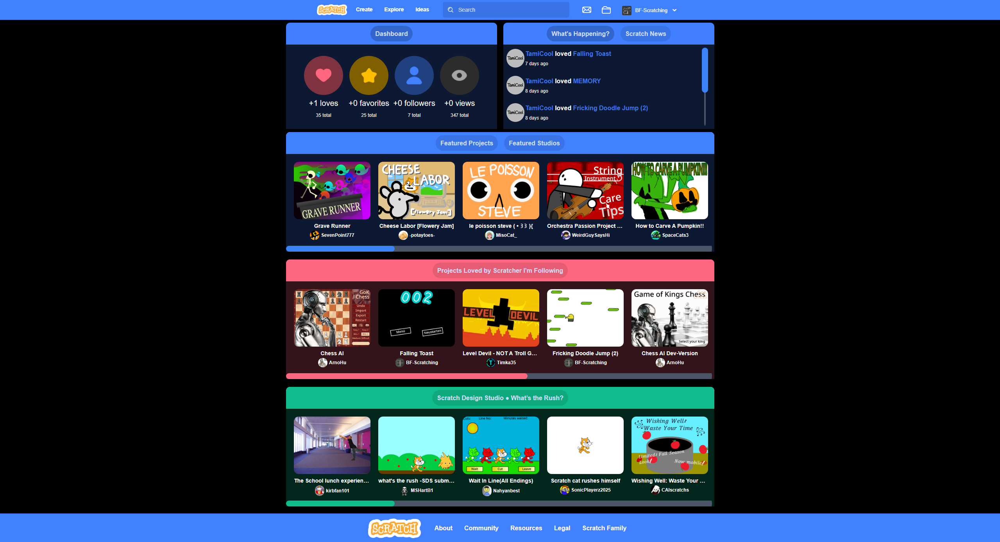
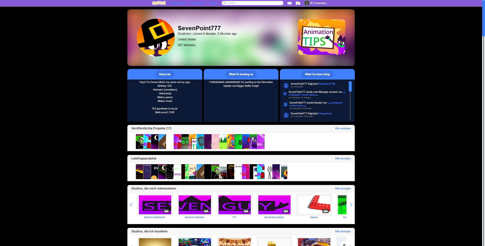

A scratch redesign extension.

This is a chrome extension, that enhances the way [scratch](scratch.mit.edu) looks.

This project is unfinished and only works if you are logged into scratch.

# How to use:

1. Download a zip of this project and unzip.
2. Open Chrome and type 'chrome://extensions' into the address bar.
3. Enable developer options in the top right corner.
4. Click load unpacked and select the folder you just unzipped.
5. Go on [scratch.mit.edu](scratch.mit.edu) and enjoy

# Screenshots:

The fully finished dashboard. It comes with project stats and shows all featured projects in a nice way.

The unfinished profile page. It has a cool looking profile overview.