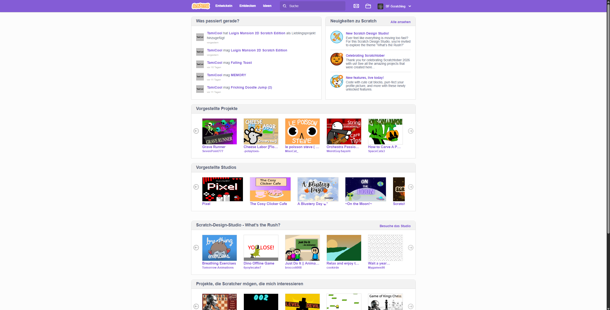
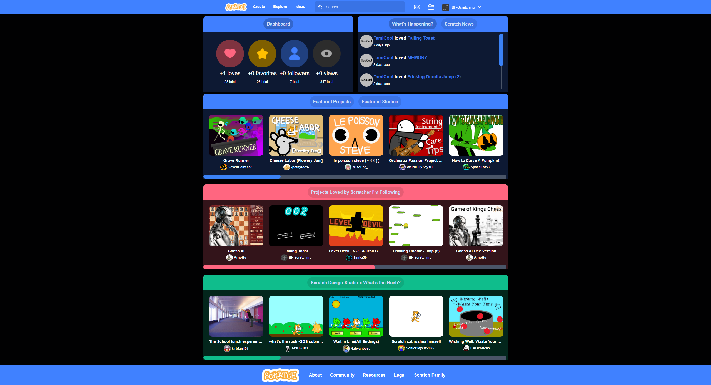
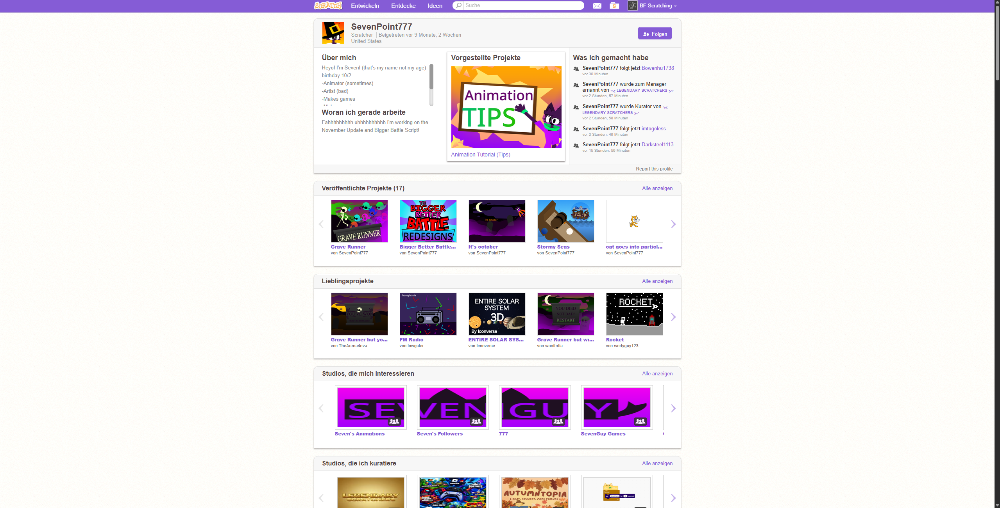

# A scratch redesign extension.

This is a chrome extension, that enhances the way [scratch](scratch.mit.edu) looks. The inspiration for this project and the design are by Jlo and his awesome project on scratch: [Scratch 4.0 Design](https://scratch.mit.edu/projects/827943393)

This project is unfinished and only works if you are logged into scratch.

The extension only works on google chrome and microsoft edge. It does not work on firefox.

# How to use:

Simply just install it from here: https://chromewebstore.google.com/detail/scratch-addon/cigdgjhpolbhhllofloabfcogmnbkpha

# Screenshots:

Old:

New:

The fully finished dashboard. It comes with project stats (like total loves, favs, followers and views), and shows all featured projects & studios in a nice way.

Old:

New:

The unfinished profile page. It has a cool looking profile overview.
